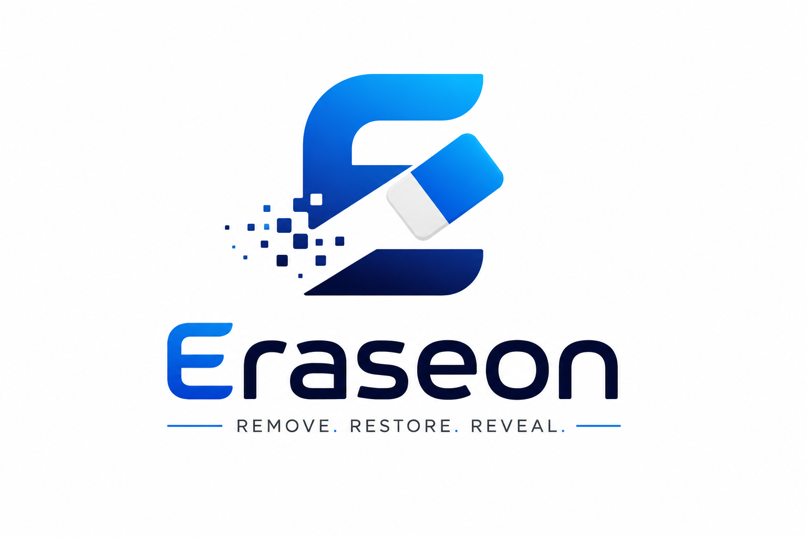

<p align="center">
  
</p>

# Eraseon

**Remove. Restore. Reveal.** — An AI-powered digital watermark & overlay cleaning application for **images** (PNG, JPG, JPEG, WEBP, BMP) and **multi-page PDFs**, featuring smart auto-detection, interactive zoomed canvas selection, Big-LaMa neural inpainting, and zero-blur YCrCb inverse alpha restoration.

---

## ✨ Key Features

1. **Images & Multi-Page PDFs**:
   - **Images**: Supports PNG, JPG, JPEG, WEBP, and BMP with lossless PNG output.
   - **PDFs**: Multi-page navigation, crisp rasterization via `pypdfium2`, per-page or template mask editing, and full multi-page PDF reconstruction.
   - **Embedded PDF Figure Detection**: Automatically locates images embedded inside white-paper PDF pages while leaving surrounding document body text untouched.

2. **Smart Auto-Detection**:
   - **Tight Rotated Polygons (`RapidOCR`)**: Detects diagonal, rotated, and horizontal watermark text with oriented polygon bounds (avoiding bounding-box inflation over facial features).
   - **AI Corner Sparkles & Container Badges**: Identifies corner diamond stars, letterbox bars, and aspect-ratio overlay pills.
   - **Scene & Document Preservation**: Protects real scene signage and dark-ink document paragraphs from false detection.

3. **Zero-Blur & Opaque Restoration Modes**:
   - **Repeating Lattice YCrCb Matte Recovery (Dekel-style)**: Extracts the sub-pixel periodic watermark matte in `YCrCb` space across aligned tiles and inverts it across all verified grid positions—preserving hair strands, skin texture, teeth, and ocean wave crests without blur.
   - **Big-LaMa Neural Inpainting**: Fills opaque logos, solid badges, corner sparkles, and letterbox bars with sensor-grain matching.
   - **Non-Repeating Stroke-Aware De-blending & Classical Fallbacks**: Supports single translucent overlays, Telea FMM, and Navier-Stokes PDE.

4. **Interactive Editor & Before/After Split View**:
   - Freehand Brush, Rectangle Box, and Eraser tools with zoom-accurate canvas coordinates (`30%`–`300%`).
   - Separate overlay canvas for crisp detection badges without polluting the inpainting mask.
   - Interactive draggable Before/After comparison slider.

---

## 🚀 Getting Started

1. **Install dependencies**:
   ```bash
   pip install -r requirements.txt
   ```

2. **Model weights (`lama.pt`)**:
   - Place Big-LaMa TorchScript weights at `backend/models/lama.pt` (or keep them in your HuggingFace cache `JosephCatrambone/big-lama-torchscript`); if absent, Eraseon falls back automatically to classical inpainting.

3. **Run Eraseon**:
   ```bash
   python run.py
   ```
   The server launches at `http://127.0.0.1:8000` and opens automatically in your browser.

---

## 🛠️ Project Structure

```text
Eraseon/
├── backend/
│   ├── main.py                         # FastAPI server & REST API endpoints
│   └── watermark_engine/
│       ├── detector.py                 # RapidOCR, embedded figure, sparkle & letterbox detection
│       ├── remover.py                  # Big-LaMa inpainting & YCrCb lattice de-blending
│       └── pdf_handler.py              # pypdfium2 PDF rasterization & reassembly
├── static/
│   ├── index.html                      # Web UI layout
│   ├── styles.css                      # Dark theme & canvas viewport styling
│   ├── app.js                          # Canvas masking, zoom alignment & split slider
│   ├── logo.png                        # Full Eraseon brand logo
│   └── eraseon-icon.png                # App header icon & favicon
├── Eraseon_ Modern Digital Cleaning Logo.png
├── requirements.txt
└── run.py                              # Application launcher
```
